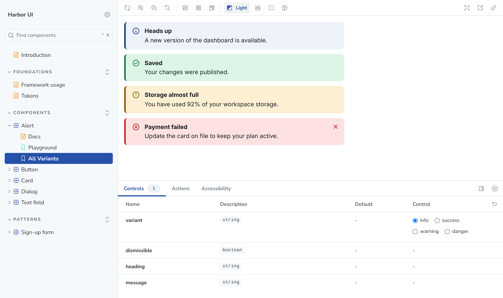

# Harbor UI

A small design system built the way larger ones are: **design tokens** at the bottom, **accessible Web Components** in the middle, and **Storybook** on top as the documentation and review surface. The components are framework-agnostic, so the same build works in Angular, React or plain HTML.

**[Live Storybook](https://wedwu.github.io/harbor-ui/)**



Harbor is a fictional brand. Every name, color and value in this repo was made up for the demo.

## What it shows

- **Two-layer tokens.** Primitives (`navy-600`, `space-4`) and semantic tokens (`color-action`, `color-danger-bg`). Components only use semantic tokens, so dark mode is a token remap with no component changes.
- **A token build with guard rails.** `scripts/build-tokens.mjs` turns `tokens/tokens.json` into CSS custom properties and a typed TypeScript map. It fails on references to primitives that do not exist, or a dark theme that is missing a token.
- **Contrast tested in CI.** `tests/tokens.test.ts` checks 21 foreground and background pairs in both themes against WCAG 2.1 ratios (4.5:1 for text, 3:1 for icons, borders and focus rings).
- **Components that use the platform.**
  - `hb-text-field` and `hb-button` are form-associated through `ElementInternals`. They submit with `FormData`, reset with the form and report validity, with no framework glue.
  - `hb-dialog` uses the native `<dialog>` and `showModal()`, so the browser handles the focus trap, Escape and inert background, and focus returns to the trigger.
  - Disabled and loading buttons stay focusable and announce their state with `aria-disabled` and `aria-busy`.
  - Labels, hints and errors are wired up with `for` and `aria-describedby` inside each component.
- **Automated accessibility and behaviour checks.** `tests/a11y-and-behavior.mjs` runs axe on every story in light and dark themes, then drives the real components in Chromium: form validation and submit, dialog focus handling and Escape, alert dismiss, and blocked clicks on disabled buttons.

## Components

| Element | Notes |
|---|---|
| `hb-button` | primary, secondary, ghost, danger; sm, md, lg; loading and disabled states; works as a form submit or reset button |
| `hb-text-field` | label, hint, error, required; joins native forms and validation; errors appear after the user leaves the field |
| `hb-alert` | info, success, warning, danger; danger uses `role="alert"`, others `role="status"`; cancellable dismiss event |
| `hb-card` | optional header and footer slots that only render when filled |
| `hb-dialog` | native modal dialog with labelled heading, close reasons and optional backdrop close |

## Run it

```bash
npm install
npm run dev            # Storybook on http://localhost:6006
npm test               # token build + contrast tests
npm run build          # library build to dist/ (ES module + tokens.css + types)
npm run build-storybook
npm run test:browser   # axe + behaviour checks against a served storybook-static on :6007
```

## Use it in an app

```html
<link rel="stylesheet" href="harbor-ui/tokens.css" />
<script type="module">import "harbor-ui";</script>

<form>
  <hb-text-field name="email" label="Email" type="email" required></hb-text-field>
  <hb-button type="submit">Subscribe</hb-button>
</form>
```

Angular needs `CUSTOM_ELEMENTS_SCHEMA` on the standalone component. React 19 passes props and custom events to custom elements directly. Both are covered with examples in the Storybook under *Foundations / Framework usage*.

## Project layout

```
tokens/tokens.json          source of truth for every token
scripts/build-tokens.mjs    JSON -> CSS custom properties + typed TS
src/tokens/                 generated tokens.css and tokens.ts
src/components/<name>/      component + stories
src/docs/                   Introduction, Tokens and Framework usage pages
tests/tokens.test.ts        theme parity and WCAG contrast
tests/a11y-and-behavior.mjs axe and browser behaviour checks
.github/workflows/          CI, then deploy Storybook to GitHub Pages
```

## Stack

Lit 3 · TypeScript · Storybook 8 · Vite · Vitest · Playwright · axe-core

## How it was built

Built with Claude as a pair programmer. I set the scope, the token architecture and the accessibility requirements, and reviewed every change.

## License

MIT
